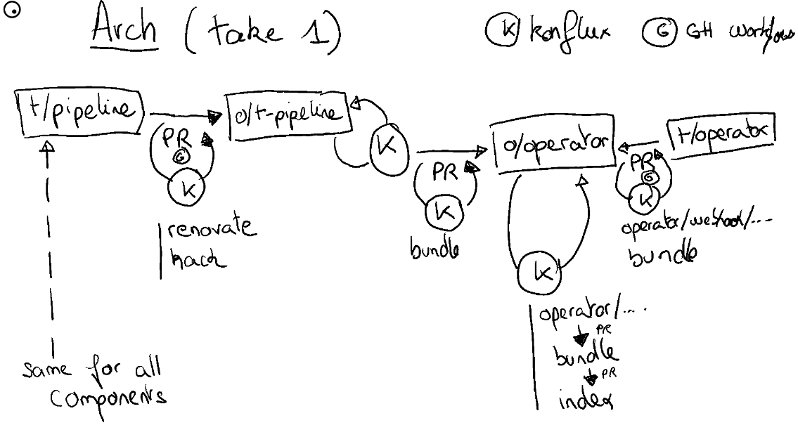
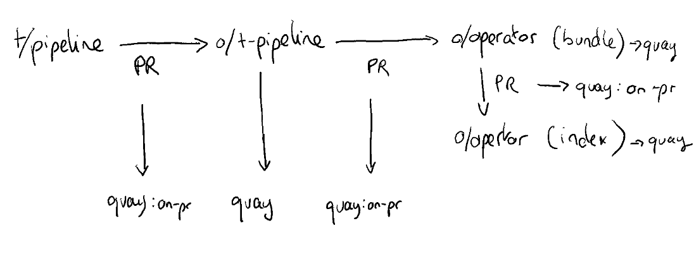

# openshift-pipelines operator repository

This is the *future* source of truth for building the OpenShift Pipelines operator with [Red Hat Konflux CI](https://github.com/konflux-ci/) instance.
This repository vendors [`tektoncd/operator`][tektoncd-operator] and gets image references from other "vendored" project from [openshift-pipelines][osp].

The list of projects that "contribute" to this are:
- [`openshift-pipelines/tektoncd-pipeline`][osp-tektoncd-pipeline] (upstream: [`tektoncd/pipeline`][tektoncd-pipeline]
- [`openshift-pipelines/tektoncd-triggers`][osp-tektoncd-triggers] (upstream: [`tektoncd/triggers`][tektoncd-triggers]
- [`openshift-pipelines/tektoncd-chains`][osp-tektoncd-chains] (upstream: [`tektoncd/chains`][tektoncd-chains]
- [`openshift-pipelines/tektoncd-results`][osp-tektoncd-results] (upstream: [`tektoncd/results`][tektoncd-results]
- [`openshift-pipelines/tektoncd-cli`][osp-tektoncd-cli] (upstream: [`tektoncd/cli`][tektoncd-cli]
- [`openshift-pipelines/tektoncd-hub`][osp-tektoncd-hub] (upstream: [`tektoncd/hub`][tektoncd-hub]
- [`openshift-pipelines/manual-approval-gate`][osp-mag]
- [`openshift-pipelines/pipelines-as-code`][osp-pac]
- [`openshift-pipelines/tekton-caches`][osp-tekton-caches]
- [`openshift-pipelines/opc`][osp-opc]

In addition, some of the configuration of this repository are generated from the [`hack` project][osp-hack].

## Structure

- [`project.yaml`](./project.yaml) holds the source of truth of most things that are generated.
  It stores all the component's built images (not released yet) as well as version numbers, …
- [`head`](./head) holds the commit SHA from [`tektoncd/operator`][tektoncd-operator] that is currently vendored.
- [`upstream`](./upstream) holds the *unchanged* vendored code from [`tektoncd/operator`][tektoncd-operator]
- [`.konflux`](./.konflux) holds openshift/openshift-pipelines specific code such as
  - [`dockerfiles`](./.konflux/dockerfiles) for the operator's images.
  - [`bundle`](./.konflux/olm-catalog/bundle) for the bundle image. 
    A lot of files in this repository are generated from the upstream code and some [`hack`](./hack) scripts.
  - [`index`](./.konflux/olm-catalog/index) for the index image.
  - [`rpms`](./.konflux/rpms) for the "prefetch" of rpms (as we build everything in an hermetic way)
- [`.github`](./.github) holds GitHub workflow configurations. Some of them are automatically generated by the [`hack` project][osp-hack].
- [`.konflux`](./.konflux) and [`.tekton`](./tekton) hold konflux and tekton manifests, and are mostly coming from the [`hack` project][osp-hack].

## Flow of *things*

TBD

## Konflux test pipelines

Two Konflux pipelines under [`.konflux/tekton`](./.konflux/tekton) run the
[`openshift-pipelines/release-tests`](https://github.com/openshift-pipelines/release-tests)
suites against an ephemeral [HyperShift](https://github.com/openshift/hypershift) cluster
provisioned per run:

- **Acceptance tests** — [`acceptance-test-pipeline.yaml`](./.konflux/tekton/acceptance-test-pipeline.yaml):
  provisions a cluster, installs the operator built from the current snapshot (via a custom
  OLM catalog), and runs the full gauge suite set.
- **Upgrade tests** — [`upgrade-test-pipeline.yaml`](./.konflux/tekton/upgrade-test-pipeline.yaml):
  installs the latest released operator from the prod `redhat-operators` catalog, creates
  upgrade-persistent resources, upgrades to the snapshot build, then verifies those resources
  survived and re-runs the suites.

Both pipelines read the **OCP minor version** encoded in the Konflux component name
(e.g. `...-index-4-20` → OCP `4.20`) in their `extract-ocp-version` task. The **acceptance**
pipeline uses it to select the compute architecture and FIPS mode (below); the **upgrade**
pipeline uses it to select the upgrade source channel, and always provisions an amd64,
FIPS-enabled cluster.

### Compute architecture by OCP minor parity (acceptance pipeline)

The **acceptance** pipeline chooses the hosted cluster's compute-node architecture by the
**parity** of the OCP minor:

| OCP minor | Example        | Compute arch | Node type (default)    |
|-----------|----------------|--------------|------------------------|
| **odd**   | 4.19, 4.21, 4.23 | `arm64`    | `m6g.2xlarge` (Graviton) |
| **even**  | 4.18, 4.20, 4.22 | `amd64`    | `m5.2xlarge`           |

The HyperShift `CONTROL_PLANE_NODE_SELECTOR` is pinned to the same architecture
(`kubernetes.io/arch=<clusterArch>`) so the hosted control plane's imagestream importer
runs on a management node of the worker architecture. This ensures `Legacy`-mode imagestream
imports resolve to the worker's arch and avoids `exec format error` on arm64 workers.

The **upgrade** pipeline always provisions amd64 (`m5.2xlarge`) compute nodes.

### FIPS by OCP minor (acceptance pipeline)

The **acceptance** pipeline enables FIPS mode only for **OCP 4.20 and older** minors:

| OCP minor      | FIPS    |
|----------------|---------|
| **<= 4.20**    | `true`  |
| **>= 4.21**    | `false` |

The **upgrade** pipeline always provisions a FIPS-enabled cluster.

### Upgrade paths

The upgrade **source** ("from" version) is selected in the upgrade pipeline's
`derive-channels` task, keyed off the OCP minor parity. For release branches `release-vX.Y.x`
the target ("to") channel is the current snapshot build's `pipelines-X.Y`; `nightly`, `next`,
and `main` builds resolve to the `latest` channel instead and require `PRE_UPGRADE_CHANNEL`
to pick a source. OLM always installs the chosen channel's head, so no explicit version pin
is needed.

| OCP minor | Upgrade type | Source channel        | Path under test                 |
|-----------|--------------|-----------------------|---------------------------------|
| **even**  | minor        | `pipelines-X.(Y-1)`   | previous **minor** → current    |
| **odd**   | z-stream     | `pipelines-X.Y` (same) | previous **patch** → current   |

For odd minors the source is confirmed by querying the prod `redhat-operators` catalog:

- channel `pipelines-X.Y` **present** → z-stream upgrade (previous patch → current).
- channel **not yet released** → fall back to the previous minor (minor → current).
- catalog state **undetermined** (transient outage) → the task fails loudly so coverage is
  never silently downgraded; re-run or set `PRE_UPGRADE_CHANNEL`.

`PRE_UPGRADE_CHANNEL` overrides the source channel unconditionally. Without an override,
`nightly`/`next`/`main` builds (target channel `latest`) error with guidance to set
`PRE_UPGRADE_CHANNEL`; supplying it lets those runs proceed.

### IntegrationTestScenario (ITS)

These pipelines are wired into Konflux via **IntegrationTestScenario** resources, which live
in the Konflux configuration (external to this repository). Each ITS references a pipeline
file in this repo through a Git resolver (`url`, `revision`, `pathInRepo`) and supplies the
snapshot plus any parameter overrides. When onboarding a new OCP minor or release branch, add
or update the corresponding ITS to point at the right `revision` and pipeline path; the
per-run cluster shape — compute architecture and FIPS mode (acceptance pipeline) and upgrade
source channel (upgrade pipeline) — is then derived automatically from the OCP minor as
described above.

## What "needs to happen" here

- We need to be able to re-build everything from scratch
  - the operator
  - the operands, such as pipeline, …
- We need to be able to push them, generate the bundle and then the image index
- We need to have this all happen in konflux…
  - … that doesn't support `ko` today
- We need to track upstream release and map to it ours.
- We need to track release branches as well

[tektoncd-pipeline]: https://github.com/tektoncd/pipeline
[tektoncd-operator]: https://github.com/tektoncd/operator
[tektoncd-triggers]: https://github.com/tektoncd/triggers
[tektoncd-chains]: https://github.com/tektoncd/chains
[tektoncd-results]: https://github.com/tektoncd/results
[tektoncd-cli]: https://github.com/tektoncd/cli
[tektoncd-hub]: https://github.com/tektoncd/hub
[osp]: https://github.com/openshift-pipelines
[osp-hack]: https://github.com/openshift-pipelines/hack
[osp-tektoncd-pipeline]: https://github.com/openshift-pipelines/tektoncd-pipeline
[osp-tektoncd-triggers]: https://github.com/openshift-pipelines/tektoncd-triggers
[osp-tektoncd-chains]: https://github.com/openshift-pipelines/tektoncd-chains
[osp-tektoncd-results]: https://github.com/openshift-pipelines/tektoncd-results
[osp-tektoncd-cli]: https://github.com/openshift-pipelines/tektoncd-cli
[osp-tektoncd-hub]: https://github.com/openshift-pipelines/tektoncd-hub
[osp-mag]: https://github.com/openshift-pipelines/manual-approval-gate
[osp-pac]: https://github.com/openshift-pipelines/pipelines-as-code
[osp-tekton-caches]: https://github.com/openshift-pipelines/tekton-caches
[osp-opc]: https://github.com/openshift-pipelines/opc
